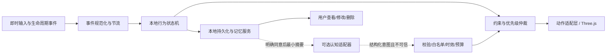

<!-- 公开仓库文档副本；私人照片不上传。原1.0.0描述的是历史设计包，当前进展以仓库根目录CONTINUE.md为准。 -->

# 最小行为 / AI / 记忆架构

状态：逻辑设计，未实现。H01：规则生命引擎必做，云端认知引擎可选且默认关闭。

## 模块与信任边界

渲染器只接收展示状态；宿主主进程负责有限系统能力与存档边界；数据服务通过窄接口交换。不得让模型、网页文本或 GLB 内容执行系统命令。大模型不计算逐帧移动、碰撞、坐标和鼠标命中。

## 本地生命引擎

状态：INTRO、IDLE、WALK、WATCH、PET_REACT、SLEEP_ENTER、SLEEP、STRETCH、MICRO、DRAG、PAUSED、HIDDEN。EXIT 属于宿主生命周期；安全错误进入 RECOVERY。每状态声明 enter/update/exit、最长持续时间、中断规则和动画映射。

行为决策建议每500ms一次；角色位移与动画按帧更新；设置/存档只在变更或检查点写入，不逐帧写盘。使用单调时钟计算帧间隔、UTC时间戳存记录，长暂停后的 delta 限幅，不能用系统时间回拨增加能量或重演事件。

短期状态建议 energy、curiosity、arousal∈[0,1]；固定人格配置与熟悉度分开。候选行为打分示意：基础权重 × 人格偏好 × 当前状态适配 × 冷却系数，再应用优先级和可达区域约束。用可设置随机种子便于回放；状态变更记录 reasonCode，不记录桌面原始输入。

建议 idle保持8–20秒、walk冷却≥30秒、micro冷却≥20秒、自主接近冷却≥120秒；用户互动可以打断，未互动不惩罚。连续相同动作最多3次，之后优先其他可行项；无候选回idle。睡眠不是完全无响应，明确摸摸触发慢醒或满足反馈。

优先级：生命周期安全操作 > 拖动 > 明确用户动作 > 规则行为 > AI建议。每次只持有一个基础动作执行权；重复事件去重，连续鼠标移动仅保留最后一个，不堆积无限队列。

## 最小持久化

| 数据 | 内容 | 默认策略（H，待合规核定） |
|---|---|---|
| PetSnapshot | schemaVersion、petId、人格种子、有限状态、位置、settings | 直到用户删除；最小必要 |
| InteractionSummary | 当日抚摸次数、最后互动时间、动作偏好计数 | 本地滚动14天；不留原始鼠标轨迹 |
| ExplicitPreference | 用户明确保存的偏好、来源、创建/更新、同意范围 | 本地直到删除；随时编辑 |
| SessionState | 即时坐标、进行中动作、短期情绪 | 内存，退出清除 |
| Diagnostics | 错误码、版本、聚合性能 | 默认本地7天；用户主动导出；不含自由文本 |

基础关系记忆=明确偏好+互动摘要+稳定人格种子，并非已具有语义理解的长期 AI 记忆。P0 不做自由对话、向量库或后台总结。推断只能标为观察，如“最近常在此处停留”，不得写成用户职业、健康或情绪事实。

存档建议 SQLite 或原子快照方案二选一，由 S04 决定。必须事务写入/临时文件替换、schemaVersion迁移、损坏检测、上次有效快照和并发单写者。禁止依赖 localStorage 承载全部关键记录。损坏恢复要告知用户；升级前备份，迁移失败可回滚版本但不能复活已删除记忆。

## 接口契约与删除一致性

详见 [数据契约](templates/DATA_CONTRACTS.md)。核心接口：dispatch(event)、getSnapshot、applySettings、listMemory、saveExplicitPreference、deleteMemory、exportLocalData、proposeIntent。所有写入带 expectedVersion；冲突返回 CONFLICT 并重新读取，不静默覆盖。

每个宠物维护 memoryEpoch。单条删除/清空/撤回同意时提升 epoch、取消请求、清理相关备份及缓存；返回 epoch 不匹配的 AI 建议或旧异步存档必须丢弃。重试按 eventId 幂等，导入存档需校验版本与大小且不覆盖删除墓碑。M01 默认不提供导入 UI，避免不完整恢复语义。

## 可选 AI 适配层（后续 / 可选验证）

只接受用户明确触发的高层意图建议。输入：最小人格摘要、允许使用的记忆摘要、可选动作白名单、有效期与预算；输出：intent、allowedAction、reasonCode、expiresAt。不得输出脚本、文件路径、OS权限或任意动画名称。

建议超时2秒、单请求在途、会话预算上限和每日额度可配置；失败、限流、断网、格式错误、越权、过期、内存 epoch变化均回规则引擎，不影响渲染。不后台无休止重试；诊断只留错误码和耗时。模型调用成本与供应商未选定，不提供虚构单价。

自由文本与检索记忆一律视为数据，不能改变系统约束。测试替身必须覆盖正常、超时、恶意动作、旧epoch和预算耗尽。M01 通过不要求真实云端模型，但必须明确报告“AI云端未接入/未验收”。

## 未来跨设备预留

petId稳定、schemaVersion明确、eventId幂等、时间用UTC、设备ID独立。未来同步需账号、鉴权、冲突策略、离线队列、删除传播、设备退出和地区数据边界；本包仅预留字段，无服务端和跨设备产品承诺。
