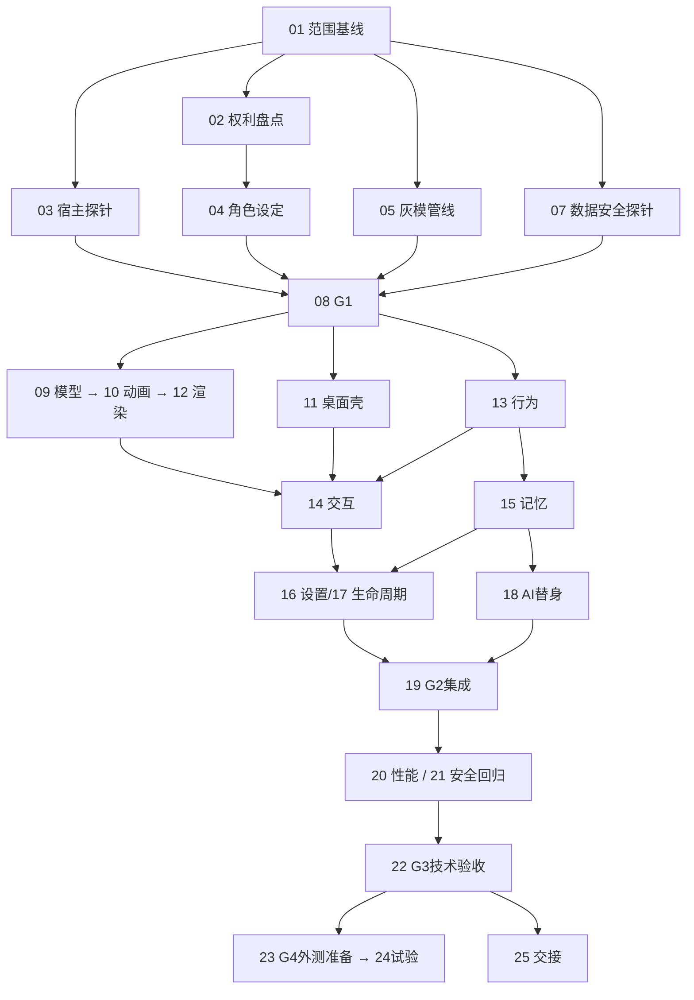

<!-- 公开仓库文档副本；私人照片不上传。原1.0.0描述的是历史设计包，当前进展以仓库根目录CONTINUE.md为准。 -->

# 完整任务拆解与依赖

状态：全部 NOT_STARTED，未派工。工时为 H06 人日估算（1人日≈6小时有效工作），不含排期承诺、等待审批、采购或外部招募。职责名称是未来 Agent 角色，不代表已启动多个 Agent。

## 工作项

| ID | 责任角色 | 任务 / 输入 | 产物与完成条件 | 前置 | 估算 | 验收映射 |
|---|---|---|---|---|---|---|
| M01-01 | Lead/Product | 范围与平台基线；读本包 | OS/硬件/版本矩阵、Q01责任决策、需求追踪表；G0签收 | 无 | 0.5 | G0 |
| M01-02 | Privacy/IP | 资料与权利盘点；照片/品牌 | 内部使用边界、素材清单、Q05/Q07待核定记录；无虚构授权 | 01 | 0.5–1 | T17/G4 |
| M01-03 | Desktop | S01透明窗口与输入穿透探针 | 真机视频+复现+资源读数；记录通过/失败及Electron采用决策 | 01 | 2–3 | T01–T08 |
| M01-04 | Character | V0.2三视图、表情与纹样；读02/照片 | 完整设定稿、120px预览、Q02签收或明确退回 | 01,02 | 2–3 | T09/G1 |
| M01-05 | Asset/Render | S02灰模导出管线 | 灰模GLB、三动作、导入/坐标/混合报告 | 01 | 1–2 | T09/T10 |
| M01-06 | Content | S03 HyperFrames候选评估 | 固定来源/版本/许可记录、10秒样片或拒用报告；不阻塞实时功能 | 01,02 | 0.5–1 | G1辅助 |
| M01-07 | Data/Security | S04存储与IPC设计探针 | 存储选择ADR、接口白名单、迁移/损坏/删除实验 | 01 | 1–2 | T14/T16/T18 |
| M01-08 | Lead | G1可行性与视觉评审 | 03/04/05/07证据审阅；Q02/Q03决策；失败分支计划 | 03,04,05,07 | 0.5 | G1 |
| M01-09 | Asset | 正式建模/UV/贴图 | .blend/GLB、预算表、纹样/材质符合02/03 | 08 | 3–5 | T09 |
| M01-10 | Animation | 绑定/表情/10个clips | 骨架映射、clip manifest、循环/中断检查视频 | 09 | 3–5 | T10 |
| M01-11 | Desktop | 桌面壳与可恢复控制入口 | 菜单栏/托盘、暂停隐藏退出、非激活显示、穿透策略 | 08 | 2–3 | T01–T06 |
| M01-12 | Render | Three.js舞台与动作适配 | GLB加载、动画混合、坐标映射、受限DPR、恢复路径 | 08,10 | 2–3 | T09/T10/T20 |
| M01-13 | Behavior | 规则状态机与事件仲裁 | 状态表、冷却/限幅、固定seed回放、暂停/拖动优先级 | 07,08 | 2–3 | T11/T19 |
| M01-14 | Interaction | 抚摸/拖动/定位/多屏 | 命中、阈值、取消、拔屏找回、底层操作无干扰 | 11,12,13 | 2–3 | T02/T03/T07 |
| M01-15 | Data | 本地记忆与存档 | 显式偏好+摘要、原子写入、迁移、删除epoch、导出 | 07,13 | 2–3 | T14–T16 |
| M01-16 | UX/A11y | 设置与辅助技术 | 键盘替代、读屏、减少动态、大小/活动量、数据管理UI | 11,14,15 | 1.5–2.5 | T13/T15 |
| M01-17 | Desktop | 生命周期与隐私默认值 | 锁屏睡眠/全屏/恢复、零外发、自动启动默认关 | 11,14,15 | 1–2 | T08/T12/T17 |
| M01-18 | AI adapter | 可选认知接口及确定性替身 | 意图schema、拒绝/超时/epoch/额度测试；不接真实模型亦可 | 13,15 | 0.5–1 | T19 |
| M01-19 | QA/Lead | G2端到端整合 | 首启到退出完整演示，FR01–FR12映射，无占位成功结果 | 12,14,15,16,17,18 | 1–2 | T01–T20 |
| M01-20 | QA/Perf | 真机性能与稳定性 | 原始读数、30分钟交互+8小时运行、资源释放与功耗代理报告 | 19 | 1–2+8h运行 | T21–T24 |
| M01-21 | Security/QA | 安全隐私/可访问性回归 | 网络/IPC/数据删除/键盘读屏证据，严重缺陷清零 | 19 | 1–2 | T13–T20 |
| M01-22 | Lead/所有者 | G3 M01技术验收 | 逐门槛结果、缺陷、残余风险、签收；未执行项不得通过 | 20,21 | 0.5 | G3 |
| M01-23 | Research/Compliance | 封闭试验准备，非收款 | 招募/同意/研究说明、适用性矩阵、构建分发方案、G4签收 | 02,22 | 1–2 | G4 |
| M01-24 | Research/Business | 14天试验与价格验证计划执行 | 分母/流失/问题/付费证据，未授权不收款；结果决定后续 | 23及实际授权 | 2–3+14天观察 | B01–B05 |
| M01-25 | Lead | 交接与里程碑关闭 | 更新CONTINUE/日志/ADR、未完成事项、包与证据索引 | 22；若试验已做则含24 | 0.5 | 交付完整性 |

## 依赖图与推进顺序

表格前置是权威；图为主链概览。06内容生产探针可独立进行，其失败不阻塞G1；真实云模型接入不是关键链。关键路径候选：01→02→04→08→09→10→12→14→16/17→19→20/21→22→25，03宿主探针失败可能成为更长路径。

建议阶段预算：G0/G1约4–7个工作日；资产与客户端并行约7–12日；整合与验收约3–5日。以角色可用且部分并行为前提，整体约3–5周；单人串行会更长。总人日以表格区间累加为准，不把人日相加当作日历工期。外测14天另计，商业实验结果不是技术里程碑已经完成的前提证据。

## 每张任务卡通用要求

执行前填输入版本、允许修改路径与依赖证据；执行后填产物、实际检查、未执行项、风险与下一步。依赖未通过可做明确标注的占位验证，不得合并为最终完成。验收不通过→记录缺陷→修复→仅重跑受影响项及关键回归→更新证据。模板见 [TASK_CARD](templates/TASK_CARD.md)。
